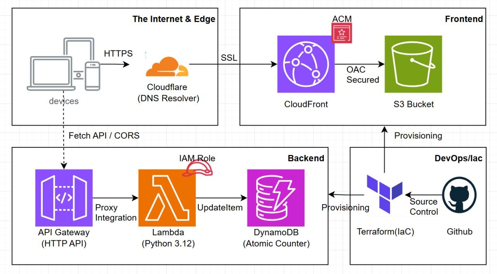
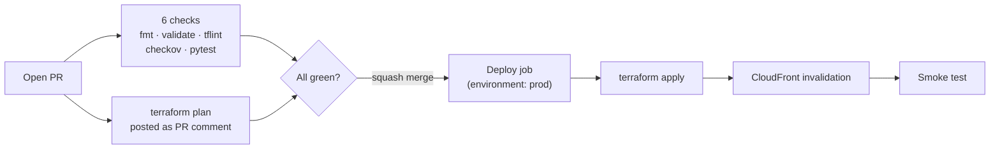

# ☁️ The Cloud Resume Challenge (Terraform & AWS Edition)

[](https://github.com/Zizo-Jo/P_The-Cloud-Resume-Challenge/actions/workflows/pr.yml)
[](https://github.com/Zizo-Jo/P_The-Cloud-Resume-Challenge/actions/workflows/deploy.yml)
[](https://www.terraform.io/)
[](https://aws.amazon.com/)
[](https://www.python.org/)

## 📖 Introduction

This project is my implementation of **The Cloud Resume Challenge**: a serverless resume website on **AWS**, fully provisioned with **Infrastructure as Code (Terraform)** and delivered through a **CI/CD pipeline** where merging a pull request updates production.

The site is a static HTML page with a dynamic **visitor counter**, backed by a Python serverless API. The focus of the project is not the page itself but how it is built, checked and shipped: **security**, **cost** (a few cents per month) and **automation**.

## 🏗️ Architecture



1.  **Frontend**: a private **S3** bucket served worldwide through **CloudFront** (CDN) using Origin Access Control, with an **ACM** certificate for HTTPS.
2.  **Backend**: **API Gateway** (HTTP API) invokes a **Lambda** function (**Python 3.12**).
3.  **Database**: **DynamoDB** stores the visitor count and updates it with an atomic `UpdateItem`, so concurrent visits are counted correctly.
4.  **DNS & edge**: **Cloudflare** manages DNS and sits in front for DDoS protection.
5.  **IaC**: **Terraform** manages the AWS resources through reusable modules, with remote state in S3.

## 🔄 CI/CD Pipeline

Everything goes through a pull request. `main` is protected, so nothing reaches production without passing the checks.



| Stage | What happens |
| :--- | :--- |
| **PR checks** | `terraform fmt`, `terraform validate`, **tflint**, **Checkov** (security scan) and **pytest** for the Lambda (DynamoDB faked with **moto**) |
| **Plan comment** | A read-only job runs `terraform plan` and posts it as a single PR comment, updated on every push, so reviewers see what a change does to AWS **before** merging |
| **Deploy** | After merge: `terraform plan -out`, then apply exactly that plan, invalidate the CloudFront cache, run a smoke test against the live site and API |
| **Protection** | A repository ruleset requires a PR and all 7 status checks, allows squash merges only, and blocks force pushes and deletion of `main` |

## 🔐 Security

- **No stored AWS credentials.** GitHub Actions signs in with **OIDC** and gets credentials that last one hour.
- **Two roles, least privilege.** `github-actions-plan` is read-only and only usable from pull requests of this repo. `github-actions-apply` can only change this project's resources and is only usable from the `prod` environment, which accepts the `main` branch only. Trust is pinned to the repository's immutable owner and repo IDs.
- **CI cannot change its own permissions.** The OIDC roles live in `bootstrap/` and are applied by hand.
- **Security scanning.** Checkov runs on every PR. Known findings are listed with a reason in [`.checkov.yaml`](.checkov.yaml); any new finding fails the build.
- **Pinned actions.** Third-party GitHub Actions are pinned to full commit SHAs, and every job declares minimal permissions.
- **State safety.** Terraform state lives in a private, versioned, encrypted S3 bucket with S3-native locking. `prevent_destroy` guards the website bucket, the counter table and the state bucket.
- **Least-privilege Lambda.** The function's role allows only `UpdateItem` on the counter item.

## 🛠️ Tech Stack

| Category | Technology | Usage |
| :--- | :--- | :--- |
| **IaC** | **Terraform** | Modules, remote S3 state with locking |
| **CI/CD** | **GitHub Actions** | PR checks, plan comments, deploy on merge, OIDC to AWS |
| **Quality & security** | **tflint, Checkov, pytest, moto** | Linting, IaC security scanning, unit tests |
| **Compute** | **AWS Lambda** | Python 3.12 backend logic |
| **API** | **API Gateway** | HTTP API (v2) with CORS configuration |
| **Database** | **DynamoDB** | NoSQL storage (on-demand billing) |
| **Storage** | **S3** | Private bucket for the static site |
| **CDN** | **CloudFront** | Global delivery, HTTPS, Origin Access Control |
| **Certificates** | **ACM** | TLS certificate |
| **DNS & edge** | **Cloudflare** | DNS and DDoS protection |
| **Identity** | **IAM Identity Center, OIDC** | SSO for humans, short-lived credentials for CI |

## 📂 Project Structure

```bash
.
├── .github/workflows/
│   ├── pr.yml              # PR checks + terraform plan comment
│   └── deploy.yml          # Apply, cache invalidation, smoke test (on merge)
├── bootstrap/              # Applied by hand: state bucket + GitHub OIDC roles
├── infra/
│   ├── envs/prod/          # The live environment (entry point, S3 backend)
│   └── modules/
│       ├── backend/        # Lambda, DynamoDB, API Gateway
│       └── frontend/       # S3, CloudFront, ACM
├── src/
│   ├── lambda/func.py      # Visitor counter
│   └── website/index.html  # Frontend
├── tests/                  # Lambda unit tests (pytest + moto)
├── scripts/smoke_test.sh   # Post-deploy check of the live site and API
├── .checkov.yaml           # Security-scan baseline, every skip has a reason
├── .tflint.hcl             # tflint AWS ruleset
└── cloudresume.drawio      # Architecture diagram source
```

## 🚀 Working with the repo

**Changing the site or the infrastructure** never needs a laptop deploy:

1. Branch, change, open a PR. Read the `terraform plan` comment.
2. When the checks are green, squash merge. The deploy runs by itself.

**Run the tests locally** (Python 3.12):

```bash
pip install -r tests/requirements.txt
pytest
```

**The `bootstrap/` stack** (state bucket and CI roles) is the only part applied by hand, on purpose, so the pipeline cannot grant itself new permissions:

```bash
aws sso login --sso-session <session>
export AWS_PROFILE=<profile>
cd bootstrap
terraform init
terraform plan -out=tfplan && terraform apply tfplan
```

## 🗺️ Roadmap

Hardening in progress, tracked as the `TODO Phase 2` lines in [`.checkov.yaml`](.checkov.yaml): API access logging, security response headers, Lambda concurrency cap, S3 versioning, DynamoDB point-in-time recovery, CORS restricted to the site's origin, and Lambda logging with retention.
